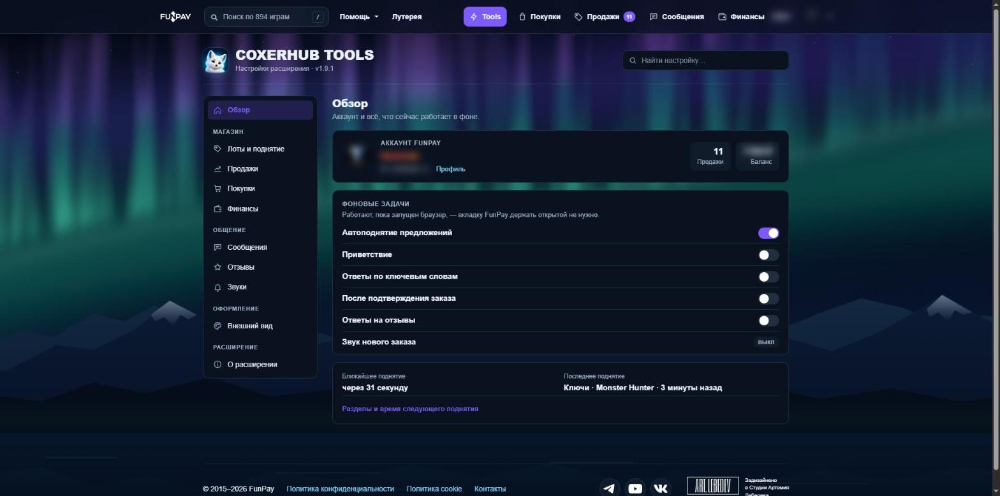
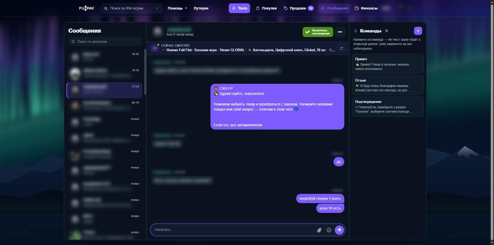
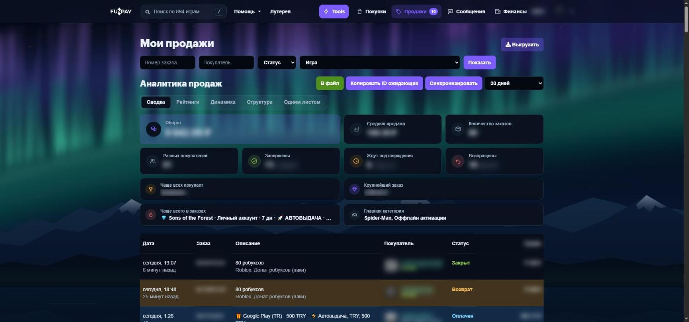
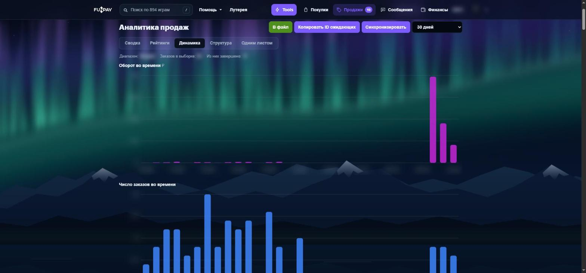
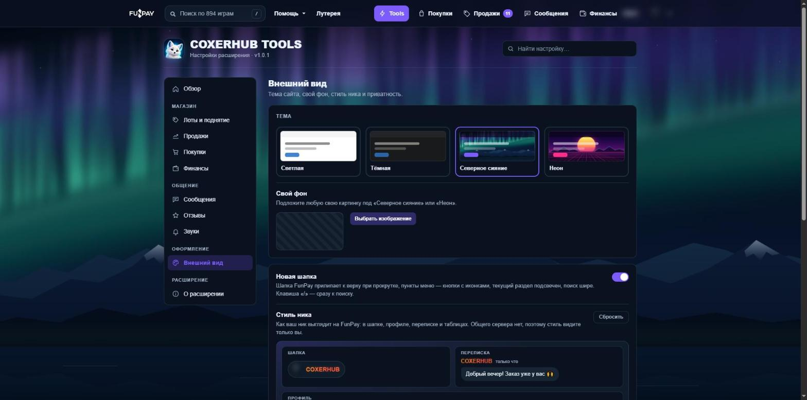
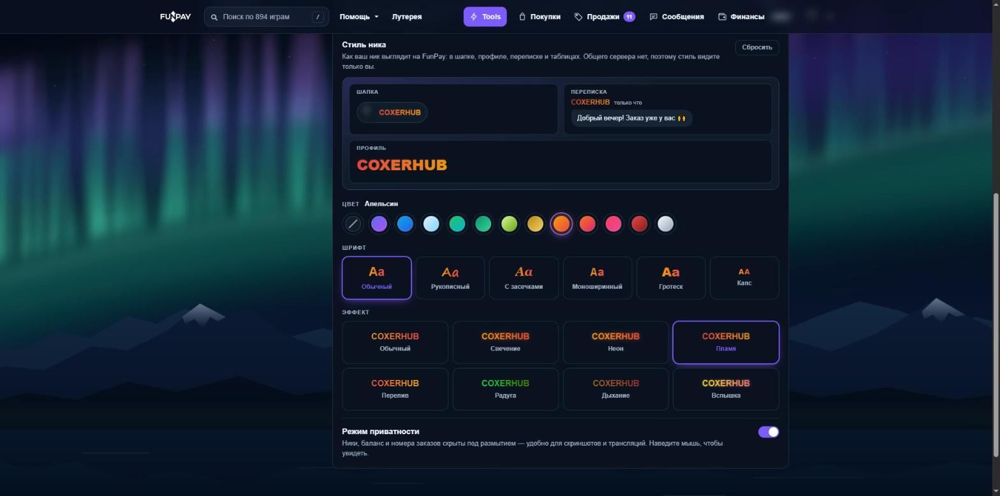

# COXERHUB TOOLS

Расширение для продавцов FunPay: автоподнятие лотов, аналитика продаж и финансов, удобный чат с командами и автоответами, массовое редактирование лотов, темы оформления и стиль ника. Все настройки — прямо на FunPay, на странице `funpay.com/tools`.

Telegram: https://t.me/funpay_coxerhub

## Возможности

**Чат**
- Сообщения пузырями, поиск по диалогам, отметки непрочитанных.
- Над перепиской видно, какой лот собеседник смотрит прямо сейчас.
- Колонка «Команды»: готовые ответы отправляются в диалог одним нажатием, `{ник}` подставляет ник собеседника.
- Кнопка «Скопировать» у каждого сообщения, эмодзи, свой звук и громкость уведомлений.
- Автоответы: приветствие, ключевые слова, после подтверждения заказа, ответы на отзывы.

**Продажи и финансы**
- Аналитика продаж, покупок и финансов: оборот, средний чек, покупатели, возвраты, графики и диаграммы.
- Выгрузка в Excel и JSON, копирование ID ожидающих заказов.

**Лоты**
- Автоподнятие и «Поднять все», массовое редактирование, порядок, экспорт и импорт лотов.
- Реальные цены с комиссией, точная цена, себестоимость, перевод лота.

**Оформление**
- Темы «Светлая», «Тёмная», «Северное сияние» и «Неон», свой фон, новая шапка.
- Стиль ника: цвета, шрифты и эффекты. Режим приватности для скриншотов и трансляций.

## Установка

Скачайте архив для своего браузера в разделе [Releases](../../releases/latest).

### Chrome, Edge, Opera, Яндекс Браузер, Brave

1. Скачайте `coxerhub-tools-chrome.zip` и распакуйте в отдельную папку, которую не будете удалять.
2. Откройте страницу расширений: `chrome://extensions` (в Edge — `edge://extensions`, в Opera — `opera://extensions`, в Яндексе — `browser://extensions`).
3. Включите «Режим разработчика».
4. Нажмите «Загрузить распакованное» и выберите распакованную папку (в ней лежит `manifest.json`).
5. Откройте FunPay — в шапке появится кнопка **Tools**.

### Firefox

1. Скачайте `coxerhub-tools-firefox.zip`.
2. Откройте `about:debugging#/runtime/this-firefox`.
3. Нажмите «Загрузить временное дополнение» и выберите скачанный zip.

Во Firefox такое дополнение работает до перезапуска браузера.

## Обновление

Скачайте новый архив, распакуйте его поверх старой папки и нажмите «Обновить» на странице расширений (или «Перезапустить» в настройках расширения на `funpay.com/tools`). Настройки и архив продаж сохранятся.

## Безопасность и данные

- Расширение не сохраняет и никуда не отправляет `golden_key`, пароли, переписки, заказы и балансы. Всё это остаётся в вашем браузере.
- Запросы с вашей авторизацией идут только на `funpay.com`.
- Для статистики использования на наш сервер раз в 12 часов уходят: ник и ID на FunPay, браузер, версия, тема и список включённых функций. Отключается в настройках: «О расширении» → «Статистика использования».
- Перевод лотов (по кнопке) отправляет текст лота в Google Translate. Курсы валют загружаются с open.er-api.com.
